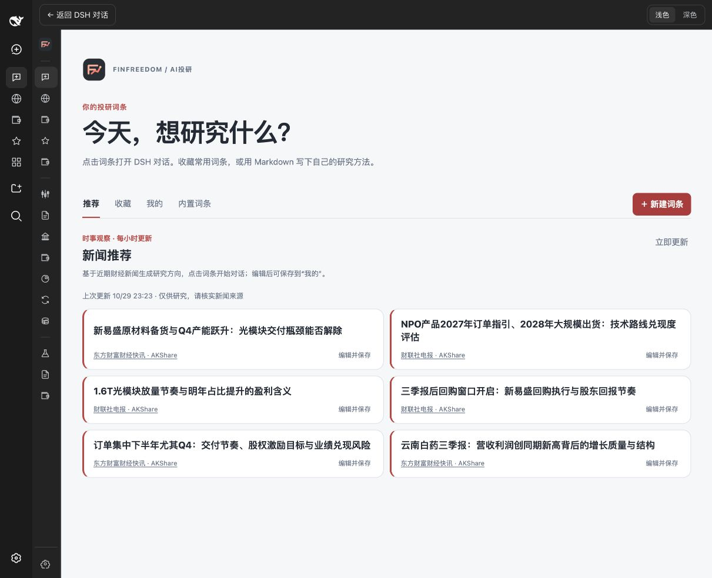
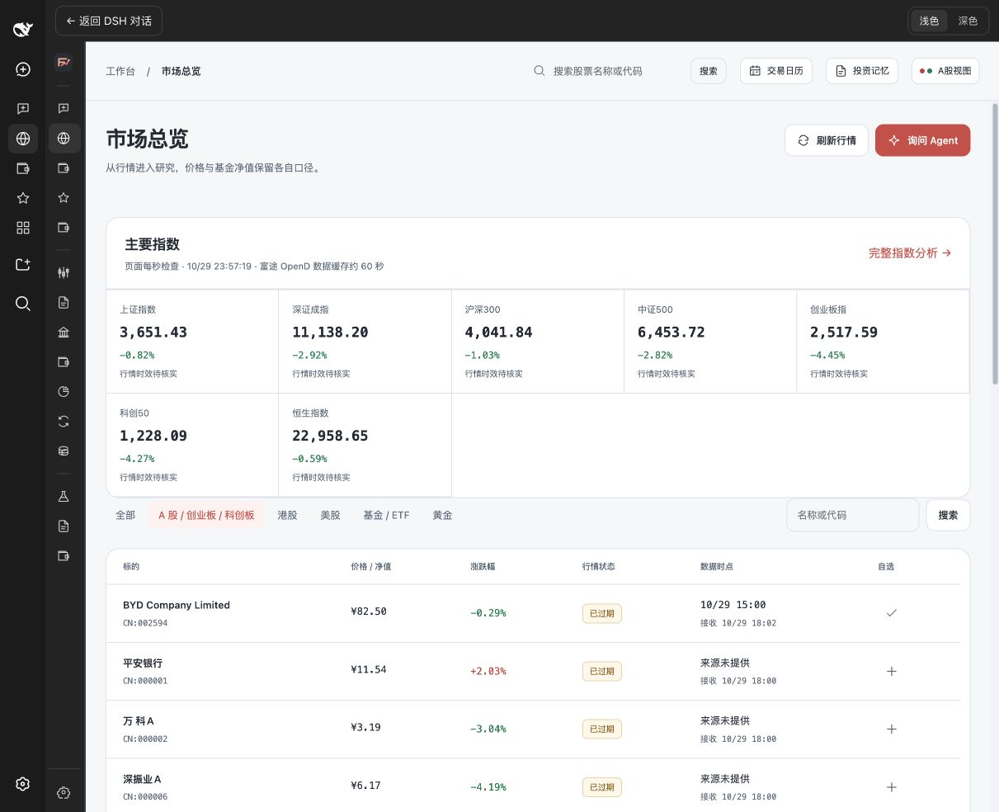
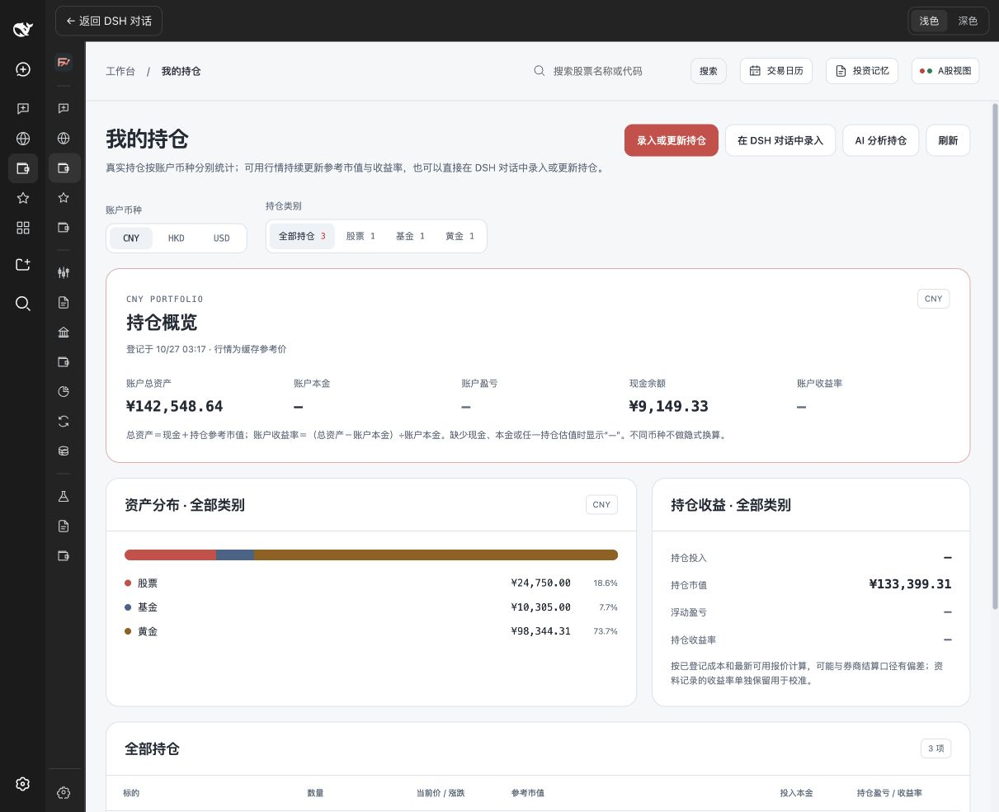

# finfreedom for DeepSeek Harness

**面向中文投资研究的 DeepSeek Harness 插件。** 在 DSH 里打开 finfreedom 工作台，查看市场与持仓、管理自选和研究词条，并让 DSH Agent 通过内置 MCP 工具和 Skills 协助分析。

[功能介绍](#功能一览) · [安装](#安装) · [使用](#开始使用) · [能力边界](#数据与能力边界) · [English](#english)



## 功能一览

- **AI 投研词条**：浏览内置投研方法和时事推荐，按类别搜索、收藏词条，创建或编辑自己的 Markdown 研究流程；选中词条即可把预设提示词带入 DSH 对话。
- **市场总览与证券查询**：查看指数、股票、基金和黄金行情，搜索标的、管理自选，并打开证券详情。
- **市场研究**：集中浏览财经新闻、公开市场流动性、资金流向、公募基金、板块轮动、黄金行情、策略研究与研报资料。
- **持仓与投资记录**：查看按账户币种划分的持仓和资产分布，通过 DSH 对话整理持仓，记录投资记忆，并使用交易日历。
- **本地模拟交易**：用本地模拟账户记录和回顾模拟交易。
- **富途 OpenD**：连接本机 OpenD 获取可用的行情和账户只读信息；通过内置 Skill 引导检查或安装 OpenD。
- **17 个随插件提供的 Skills**：包含 finfreedom 投研、市场与组合分析 Skills，以及注明来源和许可的第三方金融分析 Skills。插件安装后，DSH 会注册这些 Skills 和 finfreedom MCP 工具。

| 市场总览 | 持仓工作台（示例数据） |
| --- | --- |
|  |  |

## 安装

在 DeepSeek Harness 对话中，把此仓库链接发给 Agent 并要求安装：

```text
请安装 finfreedom 插件：https://github.com/aninstein/dsh-financial-freedom
```

也可在已安装 DSH CLI 的终端中直接安装第一个发布版本：

```sh
dsh plugin --profile web add 'github:aninstein/dsh-financial-freedom#v0.1.0'
```

启动或重启 DSH Web profile 后，在左侧工作台中打开「AI投研」或「市场总览」。后续版本可将 `v0.1.0` 换成相应的 Release tag。

### 环境要求

- DeepSeek Harness **0.1.1-rc.2 Web profile**（此版本已验证；其他版本和桌面 profile 尚未验证）。
- Node.js 22.19 或更高版本、Python 3.11 或更高版本。
- 首次启动需要网络访问 Python 包源，以自动创建插件独立环境并安装依赖。首次准备可能需要几分钟；**不需要 Docker**。
- 可选：本机富途 OpenD，用于插件支持的行情与只读账户查询。

本地开发安装：

```sh
pnpm install --ignore-scripts
dsh plugin --profile web add .
```

## 开始使用

1. 在 DSH 中打开「AI投研」，选择一个投研词条，查看或编辑提示词，再启动 DSH 对话。
2. 在「市场总览」搜索标的、查看市场快照或将标的加入自选。
3. 在「我的持仓」查看或整理持仓。通过“在 DSH 对话中录入”让 Agent 按你的描述准备持仓变更；核对后再保存。
4. 在「数据与设置」查看数据源状态、设置工作台显示，或按页面指引检查富途 OpenD。

Agent 会结合当前 DSH 会话模型和可用工具工作。市场行情、新闻和基金净值的来源与时点会显示在工作台中；涉及投资判断时，请核对原始披露和数据时间。

## 数据与能力边界

- 插件默认使用 **SQLite**，数据和插件运行环境存放在 DSH 用户目录下的 `finfreedom` 子目录。无需单独部署数据库或 Docker。MySQL 可用于需要自建数据库的部署，但工作台内的数据库连接配置目前尚未完成。
- 插件不会自动导入旧 Financial Freedom 数据。持仓页中显示的持仓是**演示/示例数据**，不能视为用户的真实账户数据；请在实际使用前核对并录入自己的数据。
- 富途 OpenD 当前用于行情和只读数据查询。插件不会提交真实订单或富途模拟订单；本地模拟交易是独立的本地账本。
- 行情和新闻取决于数据源是否可用、权限及其更新时效。缓存或过期数据会标明来源和时间；数据不可用时，相关页面可能无法提供最新信息。
- AI 图片识别取决于当前 DSH 选择的模型是否支持图像输入；本插件不额外提供视觉模型。
- 新闻推荐需要 DSH Agent 和所需数据源可运行。自动推荐不代表实时、完整或经过人工核实的投资结论。

## Skills 与 MCP

插件捆绑以下 Skills，并通过 `mcp__finfreedom` 提供市场、证券、持仓、研究资料、策略、记忆和词条相关工具：

`finfreedom-research` · `finfreedom-financial-analysis` · `finfreedom-fund-analysis` · `finfreedom-portfolio-risk` · `finfreedom-strategy-research` · `futuapi` · `install-futu-opend` · `thesis-tracker` · `sector-overview` · `earnings-preview` · `earnings-analysis` · `catalyst-calendar` · `idea-generation` · `morning-note` · `investskill-bear-case` · `investskill-fact-check` · `investskill-financial-report-analyst`

第三方 Skills 的来源、上游版本及许可见 [NOTICE.md](NOTICE.md) 和各 Skill 目录中的许可文件。安装 Skills 不会自动安装或配置其上游所需的付费数据服务。

## 开发

```sh
pnpm install --ignore-scripts
node --test tests/*.test.mjs
python -m unittest discover -s tests -p 'test_*.py'
pnpm pack
```

Python 测试需要安装 `pyproject.toml` 中声明的依赖。插件结构与投稿准备说明见 [SUBMISSION.md](SUBMISSION.md)，需求规格见 [specs/001-finfreedom-dsh-plugin/spec.md](specs/001-finfreedom-dsh-plugin/spec.md)。

## 许可证与商标

本仓库并非 OSI 批准的开源许可证项目：主体代码按 [PolyForm Noncommercial 1.0.0](LICENSE) 授权，仅允许该许可证定义的非商业用途。第三方内容采用其各自许可，详见 [NOTICE.md](NOTICE.md)。`finfreedom` 名称及相关商标归 [利长安](https://lichangan.com) 所有。

---

## English

**finfreedom is a Chinese-language investment research workspace plugin for DeepSeek Harness (DSH).** It adds a workspace, MCP tools, and 17 bundled Skills for market research, portfolio review, and investment workflows.

### Install

Send this repository URL to your DSH Agent and ask it to install the plugin:

```text
Please install the finfreedom plugin: https://github.com/aninstein/dsh-financial-freedom
```

Or install the first release from a DSH CLI:

```sh
dsh plugin --profile web add 'github:aninstein/dsh-financial-freedom#v0.1.0'
```

Restart the DSH Web profile and open **AI投研** or **市场总览** from the workspace sidebar. The validated environment is DSH `0.1.1-rc.2` Web, Node.js `22.19+`, and Python `3.11+`. The first launch creates an isolated Python environment and installs dependencies; Docker is not required.

### Features

- Search, categorize, bookmark, create, and edit Markdown investment research entries; start a DSH conversation with an entry's prompt.
- Explore market indices, equities, funds, gold, news, liquidity, capital flows, sectors, research materials, and strategy tools.
- Review holdings and watchlists, record investment notes, use the trading calendar, and track local paper trades.
- Connect to a local Futu OpenD instance for supported quotes and read-only account data.
- Use bundled finfreedom and third-party finance Skills through the DSH Agent and `mcp__finfreedom` tools.

**Limitations:** holdings shown in the workspace are demo data. Futu integration is read-only; no live or Futu simulated orders are submitted. Quote freshness depends on configured sources and permissions. Image recognition depends on the selected DSH model. The default database is local SQLite; the in-workspace MySQL connection settings are not yet implemented.

### License

The main project is licensed under [PolyForm Noncommercial 1.0.0](LICENSE), not an OSI-approved open-source license. Third-party Skills retain their respective licenses; see [NOTICE.md](NOTICE.md).
